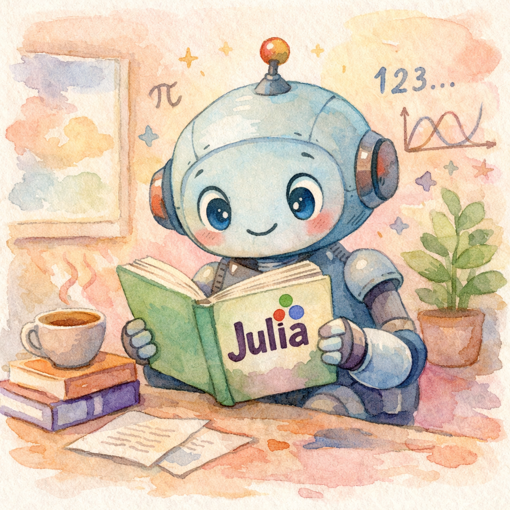

# [Image Generation](@id images_guide)

UniLM.jl generates and edits images with OpenAI's Images API (`gpt-image-2.5-sunburst`
by default) and with Gemini's native image generation, Nano Banana
(`gemini-nano-banana-2.1` by default). The request's `service` picks the provider; the
verbs and result types are the same for both.

```@setup images
using UniLM
using JSON
```

## Basic Usage

```julia
result = generate_image(
    "A watercolor painting of a friendly robot reading a Julia programming book",
    size="1024x1024",
    quality="medium"
)
println("Success: ", result isa ImageSuccess)
if result isa ImageSuccess
    imgs = image_data(result)
    println("Images: ", length(imgs))
    println("Base64 length: ", length(imgs[1]))
    save_image(imgs[1], joinpath(@__DIR__, "..", "assets", "generated_robot.png"))
    println("Image saved to assets/generated_robot.png")
else
    println("Images: 0")
    println("Image generation failed — see result for details")
end
```



## The `ImageGeneration` Type

For full control, construct an [`ImageGeneration`](@ref) object:

```@example images
ig = ImageGeneration(
    prompt="A minimalist logo for a Julia programming package",
    model="gpt-image-2.5-sunburst",
    size="1024x1024",
    quality="high",
    background="transparent",
    output_format="png"
)
println("Model: ", ig.model)
println("Size: ", ig.size)
println("Quality: ", ig.quality)
println("\nRequest JSON:")
println(JSON.json(ig))
```

## Configuration Options

| Parameter            | Provider | Values                                                | Default           |
| :------------------- | :------- | :---------------------------------------------------- | :---------------- |
| `model`              | both     | `"gpt-image-2.5-sunburst"`, `"gpt-image-2.5-flare"`, `"gpt-image-2"`; `"gemini-nano-banana-2.1"` | `""` (see below)  |
| `n`                  | both     | `1`–`10`; Gemini: `1`                                 | API default (1)   |
| `safety_identifier`  | both     | a stable id for your end user (see below)             | none              |
| `size`               | OpenAI   | `"1024x1024"`, `"1536x1024"`, `"1024x1536"`, `"auto"`; on `gpt-image-2` and later any `WIDTHxHEIGHT` with multiples of 16, up to `3840x2160` | API default       |
| `quality`            | OpenAI   | `"low"`, `"medium"`, `"high"`, `"auto"`; `"xhigh"`, `"max"` on `gpt-image-2.5-flare` / `gpt-image-2.5-sunburst` | API default       |
| `background`         | OpenAI   | `"transparent"`, `"opaque"`, `"auto"`                 | API default       |
| `output_format`      | OpenAI   | `"png"`, `"webp"`, `"jpeg"`                           | API default       |
| `output_compression` | OpenAI   | `0`–`100` (for webp/jpeg)                             | API default       |
| `moderation`         | OpenAI   | `"auto"`, `"low"`                                     | API default       |
| `aspect_ratio`       | Gemini   | `"1:1"`, `"1:4"`, `"4:1"`, `"1:8"`, `"8:1"`, `"2:3"`, `"3:2"`, `"3:4"`, `"4:3"`, `"4:5"`, `"5:4"`, `"9:16"`, `"16:9"`, `"21:9"` | API default (square) |
| `resolution`         | Gemini   | `"512"`, `"1K"`, `"2K"`, `"4K"`; `gemini-nano-banana-2.1` renders 1K, 2K or 4K | API default (1K)  |

`input_fidelity` is an image-edit parameter and belongs on [`ImageEdit`](@ref);
`ImageGeneration` does not accept it. A field set for the provider that does not take
it — `quality` on Gemini, `aspect_ratio` on OpenAI — throws `ArgumentError` naming the
provider and the field, before any request.

!!! note "The model field is a sentinel, not a resolved default"
    Unlike [`Chat`](@ref), `ImageGeneration` does not resolve its model at
    construction. The field holds `""` and resolves only when the request is
    serialized — to `"gpt-image-2.5-sunburst"` for OpenAI, `"gemini-nano-banana-2.1"`
    for Gemini — so `ImageGeneration(prompt="…").model` reads back as the empty
    string. Pass `model=` explicitly if you need to read it, or inspect
    `JSON.json(ig)` to see what will go on the wire. A service with no default image
    model throws `ArgumentError` at serialization.

## Safety Identifiers

`safety_identifier` names the end user a request is made for, so the provider's abuse
monitoring can tell your users apart; hash a username or email address rather than
sending it. OpenAI takes 1 to 128 characters (its
[safety guide](https://developers.openai.com/api/docs/guides/safety-best-practices#implement-safety-identifiers)),
on generations and edits alike; Gemini sends it as the request label
`safety_identifier`, at most 63 lowercase letters, numerals, `_` or `-`, international
ones included. OpenAI
deprecated the Images API's `user` field in its favour; the request types have no
`user` field.

```julia
using SHA
id = bytes2hex(sha256("alice@example.com"))[1:32]   # 32 hex characters fit both providers
result = generate_image("A paper boat"; safety_identifier=id)
```

## Gemini (Nano Banana)

With `service=GEMINIServiceEndpoint`, [`generate_image`](@ref) and [`edit_image`](@ref)
call Gemini's `generateContent` with image output; `GEMINI_API_KEY` must be set. Size
the image with `aspect_ratio` and `resolution` — Gemini has no `WIDTHxHEIGHT` size,
quality, background or output format control — and expect one image per request.

```julia
result = generate_image(ImageGeneration(service=GEMINIServiceEndpoint,
                                        prompt="A lighthouse at dusk, oil painting",
                                        aspect_ratio="16:9", resolution="2K"))
if result isa ImageSuccess
    save_image(image_data(result)[1], "lighthouse.jpg")
    token_usage(result)          # Gemini's usageMetadata, thinking counted as output
end

# Edit: the input image goes to Gemini inline, ahead of the prompt.
edited = edit_image("lighthouse.jpg", "Make it a winter night"; service=GEMINIServiceEndpoint)
```

The model's image parts are the result's images, in order. Gemini sends them as JPEG
(each part's `mimeType` in `result.response.raw` says so), so save them under a `.jpg`
name. Text the model sends with an image is its `revised_prompt`; the interim images of
the model's thinking are not results. A reply with no image — the image filter stopped
it, say — is an [`ImageCallError`](@ref) naming Gemini's finish reason (`IMAGE_SAFETY`,
`NO_IMAGE`, …). Gemini's reply has no creation time, so `result.response.created` is
when it arrived.

## Multiple Images

Generate multiple images in a single request (OpenAI):

```julia
result = generate_image("A cute robot learning to program", n=3, size="1024x1024")

if result isa ImageSuccess
    imgs = image_data(result)
    for (i, img) in enumerate(imgs)
        save_image(img, "robot_$i.png")
    end
end
```

## Transparent Backgrounds

Perfect for logos and icons (OpenAI):

```julia
result = generate_image(
    "A simple geometric icon of a butterfly",
    background="transparent",
    output_format="png",
    quality="high"
)

if result isa ImageSuccess
    save_image(image_data(result)[1], "butterfly_icon.png")
    # => PNG with transparent background
end
```

## Result Structure

```@example images
# Show the type hierarchy for image results
println("ImageSuccess <: ", supertype(ImageSuccess))
println("ImageFailure <: ", supertype(ImageFailure))
println("ImageCallError <: ", supertype(ImageCallError))
```

```julia
result = generate_image("A sunset over mountains")

if result isa ImageSuccess
    r = result.response

    r.created                 # Unix timestamp
    r.data                    # Vector{ImageObject}
    r.data[1].b64_json        # base64-encoded image data (nothing when delivered by URL)
    r.data[1].url             # the image URL, when the API delivered it that way
    r.data[1].revised_prompt  # revised prompt (may be nothing)
    r.usage                   # token usage Dict (token_usage(result) reads it)

    # Convenience accessors
    image_data(result)        # Vector{String}: each image's base64 data, else its URL
    save_image(image_data(result)[1], "sunset.png")
end
```

## Saving Images

The `save_image` helper decodes base64 and writes to disk:

```@example images
# Demonstrate save_image with a tiny test payload
tmpfile = tempname() * ".txt"
UniLM.save_image("aGVsbG8=", tmpfile)  # "hello" in base64
println("File saved to: ", basename(tmpfile))
println("Contents: ", read(tmpfile, String))
rm(tmpfile)
```

## Error Handling

`image_data` throws [`LLMResultError`](@ref) on an `ImageFailure` or `ImageCallError` — a
failed call has no images — so branch on the result type first:

```julia
result = generate_image("A sunset over mountains")

if result isa ImageSuccess
    save_image(image_data(result)[1], "sunset.png")
elseif result isa ImageFailure
    @warn "HTTP $(result.status): $(result.response)"
elseif result isa ImageCallError
    @error "Call failed: $(result.error)"
end
```

## Editing Images

[`edit_image`](@ref) edits an existing image from a text prompt, optionally masked to an
inpainting region (OpenAI). The convenience form takes the source image (a file path, or a
vector of paths) and the prompt; an optional `mask` path restricts edits to the mask's
transparent area:

```julia
# Inpaint: change only the masked region, described by the prompt
result = edit_image("room.png", "Add a large window with a sea view"; mask="room_mask.png")

if result isa ImageSuccess
    save_image(image_data(result)[1], "room_edited.png")
else
    println("Edit failed — see result for details")
end
```

For full control, build an [`ImageEdit`](@ref) and call `edit_image(e)`. The model defaults to
`gpt-image-2.5-sunburst` (`gemini-nano-banana-2.1` on Gemini, which takes no mask); image
editing needs the `:image_edits` capability: an endpoint that declares its capabilities
without it throws `ArgumentError` before any request.

## Retry Behaviour

`generate_image` and `edit_image` retry transient HTTP statuses (408, 429, 500, 502–504, 520–524, 529) within the request budget configured by `RequestConfig` (`max_attempts`, default 3), with exponential backoff and jitter; the wait a reply asks for (its `retry-after-ms` header, else `Retry-After`) is a floor under the jittered wait. Override per call with `config=RequestConfig(...)`. Both take `cancel=` (default: the ambient `with_cancel` token); a cancelled call returns an `ImageCallError` whose `cause` is a [`UniLMCancelled`](@ref). Every `ImageFailure` and `ImageCallError` carries the provider's `request_id` when one was sent, and a call error its exception in `cause`.

## See Also

- [`ImageGeneration`](@ref) — request configuration type
- [`ImageResponse`](@ref) — response type
- [`generate_image`](@ref) — request function
- [`image_data`](@ref), [`save_image`](@ref) — accessor/utility functions
