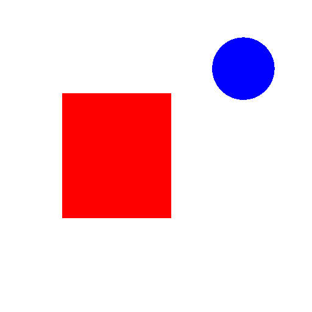

# [Route and Decide](@id system_one_guide)

Jev reads a piece of text, or a picture, and answers the questions you list
about it — which one, how much, yes or no — with a probability for each
outcome, never with generated text. Your code keeps the control flow: it asks,
reads the answer and decides what to do. Setup is one variable,
`export TYPESAFE_API_KEY=…` ([Setup](@ref jev_setup) has the rest).

| I want to… | Use | You get | Section |
| :--- | :--- | :--- | :--- |
| pick one of a set: a team, an intent | [`choice`](@ref) | the chosen option and a probability for each option | [Choice, Score, Noul](@ref jev_primitives) |
| place a text on a scale: how urgent, how severe | [`score`](@ref) | a position on your levels and a probability for each level | [Choice, Score, Noul](@ref jev_primitives) |
| know whether a statement holds: does the customer want a refund? | [`noul`](@ref) | the probability of yes | [Choice, Score, Noul](@ref jev_primitives) |
| ask several questions about one text | one [`ask`](@ref) with every question | every answer from one request, the text paid for once | [Ask many questions at once](@ref jev_many_questions) |
| fill a struct from a text | one `ask`, one question per field | a typed value and a certainty for each field | [Fill a struct in one request](@ref jev_fill_struct) |
| act only when Jev is sure, and hand the rest to a person | a confidence threshold | the answer, or a hand-over | [Act on the answer](@ref jev_act_on_answer) |
| act when some mistakes cost more than others | a price for each mistake | the cheapest action, a person included | [When mistakes have different prices](@ref jev_loss_matrix) |
| catch the messages that fit none of my options | a catch-all option | the probability that none fits | [Let Jev say none of these](@ref jev_none_of_these) |
| act on a small chance of the worst case | the probability at the top level | an alarm that a middling score would not raise | [Act on the risk of the worst level](@ref jev_worst_level) |
| judge what an image shows | an [`ImageAttachment`](@ref) in the state | answers about the picture, as about a text | [Images](@ref jev_images) |
| find where something is in an image | a [`box`](@ref) question, on Jev 1.14 | the box's edges as fractions of the image, and a confidence | [Locate with Box](@ref jev_box) |
| send a state longer than 32k tokens | `long_context = true` | 262k tokens of context, at the same price per token | [Long context](@ref jev_long_context) |

The examples on this page ask Jev, the default backend; [Backends](@ref
system_one_backends) shows how to send the same calls to OpenAI's Decisions API
or to a local model, and what each one refuses.

## First request

One call carries the text once and every question you want answered about it.
Answers come back keyed by the names you chose:

```@example jev
using UniLM

r = ask(
    "Help! My payouts have been failing for 3 days and nobody has replied to my emails.",
    "department" => choice("Which team should handle this ticket?", (
        billing   = "Payments, invoicing, payouts, refunds",
        technical = "Bugs, outages, integrations",
        sales     = "Pricing, upgrades, new accounts")),
    "urgency" => score("How urgent is this ticket?",
        ["Can wait", "Needs attention this week", "Needs attention today"]),
    "is_frustrated" => noul("Is the customer frustrated?";
        yes = "The customer expresses frustration or impatience",
        no  = "The customer is neutral or satisfied"))

if r isa SystemOneSuccess
    d = r["department"]
    println("department:    ", d.choice, "  (confidence ", d.confidence, ")")
    println("urgency:       ", r["urgency"].score, " of ", length(r["urgency"].legend) - 1)
    println("is_frustrated: ", r["is_frustrated"].noul)
    println("answered by:   ", r.response.model)
else
    println("Request failed — ", r)   # a SystemOneFailure or SystemOneCallError: returned, not thrown
end
```

The output under each block is the docs build's own: it replays an answer
recorded from a live call ([Test and Develop](@ref jev_testing_guide)). The rest
of what came back:

```@example jev
for team in ("billing", "technical", "sales")
    println("P(", team, ") = ", r["department"].probabilities[team])
end
u = r["urgency"]
println("urgency confidence ", u.confidence)
for level in 2:-1:0
    println("P(level ", level, ") = ", u.probabilities[level], "   ", u.legend[level])
end
usage = token_usage(r)
println(usage.prompt_tokens, " input tokens (billed), ", usage.completion_tokens, " output tokens")
```

The question names (`"department"`, `"urgency"`, `"is_frustrated"`) are yours
and are **not** sent to the model — they only key the answers. Write the whole
question in the instructions even when the name looks self-explanatory
([Primitives](https://docs.typesafe.ai/primitives)).

## [Choice, Score, Noul](@id jev_primitives)

Three question types cover the judgments: pick one of a set, place on a scale,
say whether a statement holds. On TypeSafe a Choice takes 1–255 options and a
Score 1–10 levels ([Limits](@ref jev_limits)); other backends set their own
([Backends](@ref backends_table)), and each limit is checked before the request.

### Choice — pick one of a named set

[`choice`](@ref) builds a question whose answer is exactly one of the options
you enumerated. The [`ChoiceAnswer`](@ref) carries `choice` (the most likely
option), `probabilities` (one per option, keyed by option name, summing to
about 1) and `confidence` (how peaked they are). Use it for a fixed set with no
order between the options: a team, an intent, a document type. A runner-up with
a real share is information your code can act on.

```@example jev
department = choice("Which team should handle this ticket?", (
    returns  = "Exchanges, wrong or damaged items",
    shipping = "Delivery status, delays, lost packages",
    billing  = "Charges, invoices, payment problems",
    other    = "Anything that fits none of the above"))

# Names alone, when the option names are already unambiguous:
tone = choice("What is the customer's tone?", ["calm", "frustrated", "angry"])
nothing # hide
```

Option order is the order of what you pass, and it is what the model reads: on
ambiguous inputs it moves the probabilities (answers stay keyed by name). Build
options and state from ordered containers — a `NamedTuple`, a vector of
`name => description` pairs or a `JSON.Object` — to choose that order. A plain
`Dict` has none of its own: its options, and its keys in a state, go out sorted
by name, so `"t10"` comes before `"t2"` — the same on every Julia version, but
not the order you wrote.

!!! details "Evidence"
    Measured on jev-1.13.0 (September 2026) on our own labeled sets, changing
    the option order shifted the probabilities of ambiguous items by 0.12 on
    average, and reversing it moved one ambiguous ticket's probability by about
    0.5; changing the key order of the state moved probabilities by up to 0.16.

The model reads each option's name as well as its description: a short name
such as `returns` is part of the prompt, and a word in the text can pull the
answer toward it. When only the description should decide, send the sentences
themselves as the names — `choice(question, collect(TEAM))` — and map the chosen
sentence back to your key, which is what [`nl_classify`](@ref) does
([Design note: what the model reads](@ref nl_dispatch_design)).

### Score — place the text on an ordered rubric

[`score`](@ref) takes the level descriptions lowest first; `levels[1]` is level
`0`, so three levels give a score in `0.0 … 2.0`. The [`ScoreAnswer`](@ref)
carries `score`, `confidence`, `legend` and `probabilities`, the last two keyed
by the **0-based level number** as an `Int`. `score` is the probability-weighted
average level, so it falls between levels: threshold it, and read
`probabilities` when the shape matters — a `1.0` can be all the probability on
level 1, or half on level 0 and half on level 2
([Score](https://docs.typesafe.ai/primitives/score)).

```@example jev
severity = score("How severe is the reported issue?", [
    "Cosmetic; no impact to functionality",
    "Broken or degraded feature, but workaround exists",
    "Blocking issue; no workaround exists"])
nothing # hide
```

Describe situations, not degrees: every level is judged on its own against the
state, without its number or its neighbours, so "worse than the previous level"
carries nothing. Keep one dimension per question.

### Noul — the probability that a statement is true

[`noul`](@ref) asks one yes/no question. The [`NoulAnswer`](@ref) is one number
in `0 … 1` — near 1 a strong yes, near 0 a strong no, near 0.5 maximal
uncertainty — and has no `confidence` field: with two outcomes the value is the
whole distribution.

```@example jev
wants_human = noul("Is the customer asking for a human agent?")

repeat_contact = noul("Has the customer contacted support about this before?";
    yes = "Mentions a prior attempt, ticket, or that they have asked before",
    no  = "No sign of any previous contact")
nothing # hide
```

A Noul is the probability that the statement holds, not a degree: "Is the
candidate strong in Python?" at 0.5 means the model is split, **not** that the
candidate is middling — ask a Score for degree
([Noul](https://docs.typesafe.ai/primitives/noul)). Phrase the question so that
a high value means yes.

### Structured criteria

Wherever guidance appears — `instructions`, a Choice option's description, a
Score level, a Noul `yes`/`no` — it may be a string, a `NamedTuple`/`Dict` or a
vector. Start with strings. When two options keep getting confused, give each
what it covers, what it does not, and a few examples:

```@example jev
return_topic = choice("Which returns topic is the customer asking about?", (
    return_policy = (what     = "Whether and how an item can be returned",
                     not_for  = "Progress of a return already sent",
                     examples = ["Can I return shoes I've worn once?",
                                 "How long do I have to return an order?"]),
    return_status = (what     = "Progress of a return already sent",
                     not_for  = "Whether and how an item can be returned",
                     examples = ["Has my return arrived yet?",
                                 "When will my refund be paid?"])))
nothing # hide
```

The field names `what`, `not_for` and `examples` are yours, not the API's. The
model reads them with the values, so keep them short and the same on every
option ([Choice](https://docs.typesafe.ai/primitives/choice)).

### Pointing a question at part of the state

When the state holds several parts — a message, a record and a policy — name the
part a question is about with its key in backticks, and keep the content in the
state rather than in the question:

```@example jev
state = (
    ticket_message = "I was charged twice for order A-104. Please refund the duplicate.",
    order          = (id = "A-104", charges = [49, 49]),
    refund_policy  = "Duplicate charges are eligible for a refund.")

r = ask(state,
    "refund_requested" => noul("Does `ticket_message` request a refund?"),
    "policy_allows"    => noul("Does `refund_policy` allow refunding the duplicate charge in `order`?"))

println("refund_requested: ", answer(r, "refund_requested"))
println("policy_allows:    ", answer(r, "policy_allows"))
```

The backticks are a prompting convention the model reads, not a server-side
resolver: a name that does not exist raises no error, it only leaves the
question vaguer. The state may be a `NamedTuple`, `Dict`, `Vector`, `Tuple`,
`String` or an image ([Images](@ref jev_images)), not `nothing`
([State](https://docs.typesafe.ai/concepts/state)), and its key order is read
too, so prefer the ordered forms.

## Reading answers

Any call that reaches the service returns one of three result types. A
malformed request — a wrong `service`, duplicate or blank question names,
invalid criteria, anything over the backend's limits — is an `ArgumentError`
before anything is sent, and inside a [`with_recorded_answers`](@ref) replay
scope a request with no recording throws [`ReplayMissError`](@ref): a gap in
the recordings is not a service failure.

| Result | Meaning |
| :--- | :--- |
| [`SystemOneSuccess`](@ref) | HTTP 200, decoded into answers |
| [`SystemOneFailure`](@ref) | the service answered with a status other than 200 ([Errors](@ref jev_errors)) |
| [`SystemOneCallError`](@ref) | no response at all: timeout, transport failure, missing key, or a 200 whose body was not a usable set of answers |

A failed call has no answers: [`answers`](@ref), [`answer`](@ref) and
`getindex` throw [`SystemOneError`](@ref) on it rather than returning an empty
map, so `r["is_unsafe"].noul > 0.9` can never read as "safe" on a call that
never happened. Where a failed call is a case your code handles, branch on
`r isa SystemOneSuccess` first, as the first example does. On a success, three
equivalent accessors reach an answer:

```@example jev
ticket = "Help! My payouts have been failing for 3 days and nobody has replied to my emails."

r = ask(ticket,
    "urgency"     => score("How urgent is this ticket?",
                           ["Can wait", "Needs attention this week", "Needs attention today"]),
    "wants_human" => noul("Is the customer asking for a human agent?"))

a = r["urgency"]              # getindex
a = answer(r, :urgency)       # by Symbol or String
every = answers(r)            # Dict{String,SystemOneAnswer}

println(a.score)              # probability-weighted position over the levels
println(a.confidence)         # how peaked the distribution is
println(a.probabilities)      # Dict{Int,Float64}, keyed by 0-based level number
println(a.legend[argmax(a.probabilities)])   # the description of the top level
println(a.raw)                # the answer as the service sent it, parsed, always kept

haskey(r, "wants_human") && println(r["wants_human"].noul)
println(collect(keys(r)))     # the question names that came back
```

The service rounds every number to two decimals, as a floating-point value: a
0.82 can arrive as 0.8200000000000001. Rounded probabilities need not sum to
exactly 1 — a live reply over four options summed to 0.99 on 20 October 2026 —
so [`ask`](@ref) accepts a sum within 0.005 per outcome of 1, and returns a reply
further off as a [`SystemOneCallError`](@ref). A Score answer is held to its own
numbers the same way: its `score` must be the expected level its probabilities
give, within that rounding, and its `legend` must repeat each level you asked as
a string, unchanged; a reply that breaks either, or names no model, is a
`SystemOneCallError` too.

**Confidence describes the distribution, not correctness.** It collapses
`probabilities` into `0 … 1`: all the mass on one outcome gives 1.0, a flat
spread a low number. For a Choice over `n` options it is
`clamp((n·p_max − 1)/(n − 1), 0, 1)`, the top probability `p_max` rescaled so
that a uniform answer scores 0
([Confidence](https://docs.typesafe.ai/confidence)). The same confidence is
therefore a different top probability for a different number of options: 0.5
means `p_max ≥ 0.75` with 2 options, 0.6 with 5 and 0.55 with 10; a Choice of
one option reports 1.0. A Score's confidence likewise measures how concentrated
the probability is around the most likely level. Low confidence on a Choice
usually means no option wins; on a Score, that the levels overlap for this
state, the question measures more than one thing, or the state does not say
enough. `confidence` is the same formula on every backend, but each model is
calibrated its own way ([Backends](@ref backends_confidence)).

!!! details "Evidence"
    The formula fits every answer we measured within 0.02, on jev-1.13.0 in
    September 2026.

**Answers vary between identical calls.** The service does not answer a
repeated request bit for bit: noise on a clear-cut input, but a decision near a
threshold can flip between two identical calls. Log what a decision was based
on — the answer's `raw`, `r.response.request_id` and `r.response.model` — and,
for reproducible tests and docs, record an answer once and replay it with
[`with_recorded_answers`](@ref) ([Test and Develop](@ref jev_testing_guide)).

!!! details "Evidence"
    Measured on jev-1.13.0 (September 2026), identical requests differed in 60%
    of repeated pairs, by 0.011 in a probability on average and by up to 0.11.

## [Ask many questions at once](@id jev_many_questions)

**The job:** learn several things about one message — which team, why, how
upset, whether the customer wants a person — without paying for the message
once per question. **Without Jev:** one classifier or one prompt per question,
or one long prompt whose answer you parse. **With Jev:** one [`ask`](@ref)
carries every question; the text is read once and each question is answered on
its own against it.

A question costs only its own tokens and barely moves the latency, which makes
**speculative** questions worth asking: include the ones whose answers matter
only for some inputs, and let the code ignore the rest ([Speculative
fan-out](https://docs.typesafe.ai/patterns/fan-out)).

!!! details "Evidence"
    The [parallel-questions
    cookbook](https://docs.typesafe.ai/cookbooks/parallel_questions) measures a
    13-question run batched into one call at 12.2x cheaper and 10.0x faster than
    13 separate calls, with no change in the answers. Measured on jev-1.13.0
    (September 2026), one question took 0.30 s and 22 questions 0.31 s.

```@example jev
TRIAGE = (
    department = choice("Which team should handle this ticket?", (
        returns  = "Exchanges, wrong or damaged items",
        shipping = "Delivery status, delays, lost packages",
        billing  = "Charges, invoices, payment problems")),
    return_reason = choice("If the customer wants to return something, why?", (
        wrong_size   = "The item doesn't fit",
        wrong_item   = "A different product was delivered",
        damaged      = "The item arrived broken or faulty",
        changed_mind = "The item is fine, the customer no longer wants it",
        other        = "A return reason that fits none of the above")),
    shipping_issue = choice("If this is a shipping problem, which kind is it?", (
        not_delivered = "The package never arrived",
        delayed       = "The package is late but still on its way",
        wrong_address = "The package went to the wrong place",
        other         = "A shipping problem that fits none of the above")),
    frustration = score("How frustrated does the customer appear?",
        ["Calm, just stating facts", "Frustrated but civil", "Very angry, strong language"]),
    wants_human = noul("Is the customer asking for a human agent?"))

r = ask("Shoes arrived two weeks late and in the wrong size. What are you going to do?", TRIAGE)

d = r["department"]
detail = d.choice == "returns"  ? r["return_reason"].choice :
         d.choice == "shipping" ? r["shipping_issue"].choice : nothing
# Both speculative answers came back; the code reads at most one and drops the other.
println("department: ", d.choice, ", detail: ", detail)
for (team, p) in d.probabilities
    team != d.choice && p > 0.25 && println("also notify: ", team)
end
println("billable input tokens: ", token_usage(r).prompt_tokens)
```

**Tune it**

- End every enumeration that might not cover an input with an `other` option,
  as two of the three Choices above do: otherwise the probability has nowhere to
  go but onto an option that does not fit.
- Questions in one request are independent: an answer never becomes context for
  another question. Send a second request only when your code cannot build it
  before the first answer arrives — because that answer decides what to
  retrieve, or which options to offer next.
- To judge many items in one request, put each under its own key in the state
  and name the key in the question — "Which team should handle ticket `t17`?" —
  as [Many Items at Once](@ref jev_algorithms_guide) does; addressing them by
  array index fails as the list grows.

!!! details "Evidence"
    Addressing items by array index (`items[17]`) collapsed to 33% accuracy at
    150 items on our own labeled set (jev-1.13.0, September 2026).

## [Fill a struct in one request](@id jev_fill_struct)

**The job:** turn a support message into a typed record — which team, how
urgent, whether the customer wants a refund — that your code can store and act
on. **Without Jev:** an LLM filling a JSON schema, whose output you then
validate and parse, or one classifier per field. **With Jev:** a struct already
says what each field may hold, so each field type maps to a question — an enum
to a [`choice`](@ref), an ordered enum to a [`score`](@ref), a `Bool` to a
[`noul`](@ref) — and one request fills them all, with a certainty per field.

Each enum value is offered to the model as its sentence in `DESCRIPTIONS`: the
sentence is the option's name, and the sentence the model picks maps back to the
value, so a value's name never reaches the model — the same idea as
`nl_classify` ([Dispatch on Meaning](@ref nl_dispatch_guide)). The constructor
only ever receives values its field types allow.

```@example jev
@enum Team billing technical shipping
@enum Urgency low normal high

struct Ticket
    team::Team
    urgency::Urgency
    wants_refund::Bool
end

const QUESTIONS = (team         = "Which team should handle this ticket?",
                   urgency      = "How urgent is this ticket?",
                   wants_refund = "Does the customer ask for their money back?")

# One table per enum: each value with the sentence the model reads for it, in the order it reads them.
const DESCRIPTIONS = Dict(
    Team    => [billing   => "Charges, invoices, refunds, payment methods, subscription prices",
                technical => "Bugs, crashes, errors, outages, integration or configuration problems",
                shipping  => "Delivery of physical goods: tracking, delays, damaged or missing parcels"],
    Urgency => [low    => "Low: a question or a minor annoyance; no loss of money, data or access",
                normal => "Normal: something is wrong, but there is a workaround or no deadline",
                high   => "High: the customer is blocked, is losing money, or has a deadline within days"])
sentences(E) = last.(DESCRIPTIONS[E])

ordinal(::Type) = false
ordinal(::Type{Urgency}) = true         # an ordered rubric: asked as a Score, not a Choice

question(::Type{Bool}, q) = noul(q)
question(E::Type{<:Enum}, q) = ordinal(E) ? score(q, sentences(E)) : choice(q, sentences(E))

# The chosen sentence, or the most likely level, back to its enum value.
value(::Type{Bool}, a::NoulAnswer) = a.noul >= 0.5
value(E::Type{<:Enum}, a::ChoiceAnswer) = only(v for (v, s) in DESCRIPTIONS[E] if s == a.choice)
value(E::Type{<:Enum}, a::ScoreAnswer) = first(DESCRIPTIONS[E][argmax(a.probabilities) + 1])   # levels count from 0
certainty(a::NoulAnswer) = abs(2a.noul - 1)             # 0 at a coin flip, 1 at a sure yes or no
certainty(a::Union{ChoiceAnswer,ScoreAnswer}) = a.confidence

# One request for the whole struct. A failed call throws: it never becomes a default T.
function extract(::Type{T}, text) where {T}
    fields = fieldnames(T)
    r = ask(text, [String(f) => question(fieldtype(T, f), QUESTIONS[f]) for f in fields])
    (T((value(fieldtype(T, f), answer(r, f)) for f in fields)...),
     NamedTuple{fields}(map(f -> certainty(answer(r, f)), fields)))
end

ticket, certainties = extract(Ticket, "I was charged twice this month. Refund the duplicate now!")
for f in fieldnames(Ticket)
    println(rpad(f, 13), rpad(getfield(ticket, f), 9), "certainty ", certainties[f])
end
```

The ticket comes back as a `billing` ticket of `high` urgency that asks for a
refund, and urgency is its least certain field (0.72).

On 32 hand-labeled tickets, one request per ticket filled a five-field version
of this struct at 0.979 accuracy per field. A confidence threshold tuned for one
option wording may not carry over to another: with the sentences as option
names, the Choice confidence on that set came out slightly lower at the same
accuracy.

!!! details "Evidence"
    Measured on jev-1.13.0 (September 2026) on 32 hand-labeled tickets and a
    five-field version of this struct, both encodings in one session, runs
    interleaved. Sentences as the option names (this recipe): 0.979 per field
    over three runs (0.981, 0.981, 0.975); exact-match rate 0.896. Labels with
    the sentences as their descriptions (the other common encoding), same session:
    0.981 in all three runs; exact-match rate 0.906. The whole gap
    is one near-tie flip (0.40 vs 0.39) in the urgency Score, whose question is
    identical under both encodings; neither encoding made an error on a Choice
    field. Across the three runs, 1 of 480 predictions changed: that urgency
    near-tie.

    The three-field struct above: both encodings 0.974 per field (team 1.0 on 21
    gradable items, urgency 0.923 on 26, wants_refund 1.0 on 32).

    Choice confidence was somewhat lower with the sentences as option names
    (department: mean 0.894 vs 0.910; 24 vs 18 of 96 answers below 0.8), with no
    change in accuracy. Input tokens per request: 627 with the sentences as
    option names, 706 with labels and descriptions.

    From an earlier run on the same items and questions: gpt-5.6-luna filling a
    strict JSON schema reached 0.967 per field, at a median latency of 1.3–1.5 s
    against 0.28 s for Jev, and changed 1–3% of its fields between runs.

    Limits: 32 items, one annotator. The Choice fields are at ceiling under both
    encodings, so this set can show a loss but not a gain; the encoding study on
    keyword traps, in Dispatch on Meaning's [design note](@ref
    nl_dispatch_design), is where sentences measurably beat labels.

**Tune it**

- Keep the questions and sentences in code, as `QUESTIONS` and `DESCRIPTIONS`
  do. Field docstrings look like their natural home, but reading them goes
  through Julia's non-public docstring internals, and they are silently absent
  when the struct itself has no docstring.
- An ordered enum is a rubric: mark it `ordinal`, so it is asked as a Score,
  and list its sentences lowest first.
- Read `certainties` before you store a record: a low value marks the field to
  check.

## [Act on the answer](@id jev_act_on_answer)

**The job:** send each message to the team that handles it, and hand the ones
Jev is unsure about to a person. **Without Jev:** keyword rules per team, and a
queue for whatever they miss. **With Jev:** one Choice per message, and its
`confidence` says when to hand over.

```@example jevdecide
using UniLM

const MESSAGES = [
    "I was charged twice for order #4471. Please refund the duplicate payment.",
    "The app crashes every time I open my order history. iPhone 15, latest version.",
    "My parcel was due last Monday and the tracking hasn't moved in six days.",
    "Do you ship to Norway, and how much does delivery cost?",
    "The phone I received has a cracked screen and the box was crushed. I want my money back.",
    "Your update deleted my saved addresses and now I can't check out. Third time this month!",
]

const TEAM = (billing   = "payments, charges, invoices or refunds",
              technical = "the app or the website does not work as expected",
              shipping  = "a parcel that is late, lost or arrived damaged",
              other     = "anything else")

# The sentences are the options, so the model reads only those; `findfirst` maps the chosen one to its key.
const WHICH_TEAM = choice("Which team should handle this message?", collect(TEAM))

for message in MESSAGES
    a = ask(message, "team" => WHICH_TEAM)["team"]
    team = findfirst(==(a.choice), TEAM)            # :billing, :technical, :shipping or :other
    println(rpad(a.confidence >= 0.8 ? team : :person, 10), rpad(a.confidence, 6), message)
end
```

Four messages go straight to their team. Two go to a person: the question about
delivery to Norway (confidence 0.67), and the cracked phone (0.75), a damaged
parcel and a refund request in one message.

A Jev answer is a calibrated distribution: the answer says *what*, the
distribution says *whether to act on it*. Calibration holds across groups of
answers, not for any single one — a high confidence says the distribution is
peaked, not that this answer is right — so each policy below is one rule
applied to every answer.

!!! details "Evidence"
    Measured on jev-1.13.0 (September 2026) on our own labeled sets: over 129
    routed tickets the expected calibration error was 0.015, and the 113 answers
    whose top probability was at least 0.9 were 99.1% correct. Other sets
    measured higher errors: 0.047 on a stress set of 100 items built on the
    model's documented failure modes, and 0.071 on 74 yes/no (Noul) answers,
    which were underconfident.

**Tune it**

- The bar is your policy, not the model's: a read-only action can act at a much
  lower confidence than a refund. Start conservative, measure on your own
  messages, and move it — and pin the model first, since a tuned bar is a claim
  about one version ([Models and versions](@ref jev_models)) and one backend: on
  our labelled tickets the same 0.8 sent twice as many to a person on OpenAI's
  Decisions API as on Jev ([Backends](@ref backends_confidence)).
- Confidence is rescaled for the number of options, so adding a team moves the
  bar ([Reading answers](@ref)); rewording the options moves it too
  ([Fill a struct in one request](@ref jev_fill_struct)).
- `nl_classify` packages this pattern — the sentences as options, the key back,
  a `min_confidence` gate or a `decide` policy — in one call ([Dispatch on
  Meaning](@ref nl_dispatch_guide)).

### [When mistakes have different prices](@id jev_loss_matrix)

**The job:** route tickets when a wrong refund costs far more than a wrong
tracking link, with "ask a person" as one of the actions at its own price.
**Without Jev:** one confidence threshold for every action, tuned on labeled
tickets. **With Jev:** write down the price of each mistake; the calibrated
probabilities give every action's expected cost in one line of arithmetic, and
the cheapest action — the Bayes action — wins.

```@example jevdecide
# Minutes of staff time. A person resolves any ticket in HUMAN minutes. A wrong automated
# action does its own harm and still ends with that person, so it is priced as both.
const HUMAN = 2.0
const HARM = (refund = 8.0, cancel_subscription = 10.0, shipping_delivery = 1.0, other = 0.5)
cost(action, truth) = action === :escalate ? HUMAN : action === truth ? 0.0 : HARM[action] + HUMAN

const WANTS = "What does the customer primarily want us to do?"
const OUTCOMES = (refund              = "The customer asks to get money back.",
                  cancel_subscription = "The customer wants to cancel or not renew a subscription.",
                  shipping_delivery   = "The status, tracking, delay or address of a delivery.",
                  other               = "None of the above.")
const INTENT = choice(WANTS, OUTCOMES)

function triage(message)
    a = ask(message, "intent" => INTENT)["intent"]
    expected(action) = sum(a.probabilities[String(t)] * cost(action, t) for t in keys(OUTCOMES))
    action = argmin(expected, (:escalate, keys(OUTCOMES)...))           # the Bayes action; a tie escalates
    (action = action, expected_cost = round(expected(action); digits = 2),
     argmax = a.choice, confidence = a.confidence)
end

const TICKETS = ("Where is my parcel? Tracking hasn't moved in a week.",
                 "I was charged but my order never shipped.",
                 "Your update broke everything. I'm done with you, and I want this month back.")
for ticket in TICKETS
    println(ticket, "\n  => ", triage(ticket))
end
```

The second ticket's most likely intent is a refund (confidence 0.69), yet the
rule escalates it: a wrong refund costs 10 minutes against a person's 2, and at
these probabilities the person is cheaper. The third ticket is refunded
(expected cost 1.0), and the first goes to shipping at no expected cost.

On our labeled tickets this rule had a lower held-out cost than the best tuned
threshold (56.5 against 83.5), and it needs no labels to set — only prices.

!!! details "Evidence"
    Measured on jev-1.13.0 (September 2026) with this question and this cost
    table, on our 129 labeled tickets (their labels mapped onto these four
    outcomes, two-fold cross-validation): the Bayes rule's held-out cost was
    56.5 against 83.5 for the best `min_confidence` tuned on the other fold, and
    the 95% bootstrap interval of the paired difference, −53.0 to −8.0, excluded
    zero. The Bayes rule escalated 2 of the tickets, the tuned threshold 18. The
    threshold needed labeled tickets to tune; the Bayes rule needs none — only
    costs.

    An earlier table of ours priced a wrong `other` below escalation, and its
    Bayes rule escalated no ticket at all.

**Tune it**

- Price a wrong automated action as its harm **plus** the person who then fixes
  it. Priced at its harm alone, a cheap action such as `other` (0.5) would
  undercut escalation (2.0) under every distribution and become a free hedge:
  nothing would ever reach a person.
- The same arithmetic can decide inside `nl_classify`, [`nl_dispatch`](@ref)
  and [`@branch`](@ref): their `decide` keyword takes a function of the answer
  that returns the option to act on, or `nothing` to hand the case to
  `fallback`. A threshold is itself such a policy, so `decide` replaces
  `min_confidence` ([Confidence and control](@ref nl_dispatch_control)).

### [Let Jev say none of these](@id jev_none_of_these)

**The job:** notice the messages that fit none of your options, instead of
forcing each onto one. **Without Jev:** read low confidence as "out of scope",
which misses the out-of-scope messages a model routes confidently. **With
Jev:** add a catch-all option; its probability is the out-of-scope signal. Here
the same message is asked against a closed and an open option set, as two
questions in one request:

```@example jevdecide
const IN_SCOPE = ["refund"           => "The customer asks to get money back.",
                  "technical_issue"  => "The product, app or website is malfunctioning.",
                  "billing_question" => "A question about a charge, invoice, price or payment method."]
const CLOSED   = choice(WANTS, IN_SCOPE)
const OPEN_SET = choice(WANTS, [IN_SCOPE; "other" => "None of the above."])

for message in ("The export button crashes the app.",           # in scope
                "Please add a dark mode, it would be great.",   # out of scope
                "What's the capital of Australia?")             # out of scope
    r = ask(message, "closed" => CLOSED, "open_set" => OPEN_SET)
    closed, open_set = r["closed"], r["open_set"]
    println(rpad(message, 44), " closed: ", rpad(closed.choice, 16), " confidence ", closed.confidence,
            " | open: ", rpad(open_set.choice, 16), " P(other) ", open_set.probabilities["other"])
end
```

In the closed set both out-of-scope messages went to `technical_issue`,
"Please add a dark mode" at confidence 1.0. With a catch-all, `P(other)` took
both at 1.0, and the in-scope message kept its team.

On our labeled set, the catch-all's probability separated the out-of-scope
messages perfectly; one minus the top probability of the closed question did
not.

!!! details "Evidence"
    Measured on our labeled set (25 out-of-scope and 104 in-scope tickets):
    `P(other)` from a catch-all option separated the out-of-scope inputs
    perfectly (AUROC 1.00), while one minus the top probability of the same
    question without the catch-all did not (AUROC 0.86); the extra option left
    in-scope accuracy unchanged (0.962 either way).

**Tune it**

- A confidence threshold is not an out-of-scope detector; a catch-all option
  is. Add one wherever the options might not cover every input.
- On our set the catch-all cost no in-scope accuracy, so there is little reason
  to leave it out.

### [Act on the risk of the worst level](@id jev_worst_level)

**The job:** page someone when a report might be critical, even when it is
probably not. **Without Jev:** a severity label or an average score, which hides
a small but real chance of the worst case. **With Jev:** read the probability
mass at and above the worst level, and page when it beats the ratio of your
prices. A [`ScoreAnswer`](@ref)'s `score` is the probability-weighted average —
fine for ranking, misleading for a decision whose cost sits on one level.

```@example jevdecide
const SEVERITY = score("How severe is the problem this customer reports?", [
    "No problem: a question, praise, or feedback",
    "Minor: a cosmetic issue or small inconvenience; everything still works",
    "Moderate: a feature is broken or degraded, but there is a workaround",
    "Major: a core feature is unusable for this customer, with no workaround",
    "Critical: data loss, a security breach, a physical safety risk, or an outage"])

# P(level ≥ k): the probability mass at or above rung k (levels count from 0).
at_least(a::ScoreAnswer, k) = sum(p for (level, p) in a.probabilities if level >= k; init = 0.0)

# A false page costs 1, a missed critical report costs 10: page when P(critical) > 1 / (1 + 10).
for message in ("The tooltip on the export icon is misspelled.",
                "The heater smelled like burning for a moment. Might have been dust, might not.",
                "Our whole customer database was deleted after your update.")
    a = ask(message, "severity" => SEVERITY)["severity"]
    println(rpad(message, 80), " score ", a.score, "  P(critical) ", round(at_least(a, 4); digits = 2),
            "  page: ", at_least(a, 4) > 1 / 11, "  (score ≥ 3.5: ", a.score >= 3.5, ")")
end
```

The heater report's score, 2.24, sits in the middle of the scale, where a
threshold at 3.5 does not fire, yet it puts 0.4 on "critical" — far above the
1/11 that pays for a page.

Paging pays when the expected cost of silence, 10 · P(critical), exceeds that
of a false alarm, 1 · (1 − P(critical)) — that is, when P(critical) > 1/11. The
two rules part only on split distributions like the heater's; on our labeled
severity reports they never did.

!!! details "Evidence"
    The two rules part only on such split distributions: on our 75 labeled
    severity reports none occurred, and both made identical decisions.

**Tune it**

- The cut is the ratio of your prices: with a false page at `c_false` and a
  missed critical report at `c_miss`, page when P(critical) >
  `c_false / (c_false + c_miss)`.
- Keep `score` for ranking and for thresholds on the middle of the scale; read
  the tail when one level carries the cost.

## [Images](@id jev_images)

**The job:** judge what a picture shows — the photo a customer attached, a
screenshot of an error — with the questions you ask about a text. **Without
Jev:** a vision LLM whose description you parse. **With Jev:** put an
[`ImageAttachment`](@ref) in the request, and a Choice, Score or Noul is
answered about it as about a text.

The picture here is a test image of 512 × 512 pixels: a red rectangle and a
blue disc on white.



```@example jev
scene = ImageAttachment("../assets/scene.png")      # a PNG or JPEG file, or its bytes

r = ask((message = "I ordered the round blue sticker. Is that what the photo shows?", photo = scene),
        "shows_it"  => noul("Does `photo` show what `message` asks about?"),
        "red_shape" => choice("What is the red shape in `photo`?",
                              ["a rectangle", "a disc", "a triangle", "there is no red shape"]))

println("P(the photo shows it) = ", r["shows_it"].noul)
println("red shape: ", r["red_shape"].choice, " (confidence ", r["red_shape"].confidence, ")")
println(token_usage(r).prompt_tokens, " input tokens")
```

The message and the picture went out in one state, and each question names its
part in backticks. Jev puts 0.82 on the photo showing what the customer asks
about, and names the red shape a rectangle at confidence 1.0. The picture is
most of the 1,114 input tokens: about 720 of them, by the measurement below.

An image may stand anywhere a string can: in the state, alone or among text in a
`NamedTuple`, `Dict`, vector or tuple; in a question's instructions; in its
criteria — a Choice whose options are example pictures, a Score whose levels
are. A Score level that is an image comes back in the answer's `legend` as the
same `ImageAttachment`. UniLM looks for images in those containers, not in the
fields of a struct of your own: a request whose image only a struct holds is
refused with an `ArgumentError` before anything is sent, rather than writing the
image's bytes into the JSON as numbers.

- **Sent once, billed per use.** Each distinct image goes out once, as a part of
  a multipart request, and every place it stood holds a reference to it. Every
  use is billed, so an image several questions need belongs in the state, once.
- **The opt-in.** TypeSafe marks images experimental — their request format,
  answers and limits may change between releases
  ([Images](https://docs.typesafe.ai/images)) — and reads them only from a
  request that carries the header `TypeSafe-Danger-Zone-Images: true`. UniLM
  adds it whenever a request holds an image: passing one is the opt-in.
- **Checked before sending.** PNG or JPEG, a still image (no animated PNG), at
  most 16 MiB, 280 to 1568 pixels on each side, a JPEG ending with its
  end-of-image marker (one cut short is refused); the whole request at most
  32 MiB. TypeSafe applies no EXIF rotation, so turn a photo's pixels upright
  before you send it.
- **Other backends.** OpenAI's Decisions API takes images in the state only;
  UniLM's Ollama wrapper sends none yet ([Backends](@ref backends_table)).

!!! details "Evidence"
    Observed on 19 October 2026 (`jev-1.13.0`): an image of W × H pixels was
    billed 2·⌈W/28⌉·⌈H/28⌉ input tokens, plus about 4 for each use — 722 for a
    512 × 512 picture, 200 at 280 × 280, 6,272 at 1568 × 1568 — and the same
    image used twice in one request was billed twice. TypeSafe does not document
    this formula: it is our fit to six sizes, not a contract.

**Tune it**

- Crop to what the question is about: a smaller image costs fewer tokens, as
  long as each side stays between 280 and 1568 pixels.
- Name the image's key in the question, `photo` above, as you would name any
  part of the state.

## [Locate with Box](@id jev_box)

**The job:** find where something is in a picture: the dent on a parcel, the
signature on a form. **Without Jev:** an object detector trained on your
classes, or a vision LLM asked for coordinates as text. **With Jev:** a
[`box`](@ref) question names what to locate, and the answer is a
[`BoxAnswer`](@ref): the box's edges as fractions of the image, and a
confidence.

A Box needs Jev 1.14 or later — `model = "jev-1.14.0"`, or `"jev-preview"`. In
October 2026 `jev-latest` answers as Jev 1.13, which refuses a Box question with
HTTP 400 and `"Invalid request."`; [`ask`](@ref) returns that
[`SystemOneFailure`](@ref) with a hint naming the models that answer one
([Models and versions](@ref jev_models)).

```@example jev
r = ask(scene, "rectangle" => box("the red rectangle"), "disc" => box("the blue disc"); model = "jev-1.14.0")

for name in ("rectangle", "disc")
    b = r[name]
    println(rpad(name, 10), b.box, "  confidence ", b.confidence)
end
# Edges are fractions: of the height for top and bottom, of the width for left and right.
pixels(f) = round(Int, 512f)
b = r["rectangle"].box
println("rectangle: rows ", pixels(b.top), "–", pixels(b.bottom), ", columns ", pixels(b.left), "–", pixels(b.right))
```

The rectangle is drawn at 0.30–0.70 of the height and 0.20–0.55 of the width —
rows 153–358 and columns 102–281 of the 512 — and the disc at 0.12–0.32 and
0.68–0.88: every edge of both answers is within 0.02 of the drawing.

A [`BoxAnswer`](@ref) holds `box`, a [`BoxCoordinates`](@ref) — `top` and
`bottom` as fractions of the image's height from its top edge, `left` and
`right` as fractions of its width from its left edge, so `(0, 1, 0, 1)` is the
whole image — then `confidence`, `nothing` when the model reports none, and
`raw`. A Box question needs an image in the request, and [`ask`](@ref) refuses
one without before anything is sent:

```@example jev
try
    ask("The parcel arrived with a dent on its left side.", "dent" => box("the dent"); model = "jev-1.14.0")
catch err
    println(sprint(showerror, err))
end
```

Sent anyway, such a question still gets a box — at a confidence of 0.04 when we
tried it — and no box drawn on a picture that is not there means anything. An
answer whose box is turned inside out, its top below its bottom or its left
right of its right, is a [`SystemOneCallError`](@ref). Only TypeSafe answers Box
questions; the other backends' wrappers refuse them ([Backends](@ref
backends_refusals)).

!!! details "Evidence"
    Measured on 19 October 2026 (`jev-1.14.0`) on this picture, in a run apart
    from the answer above: every edge of both boxes came back within 0.02 of the
    drawing then too. A Box question about a request with no image came back
    with a box at confidence 0.04. Limits: one picture, two shapes on a plain
    background.

**Tune it**

- Name the target as a person would point at it — "the red rectangle", not
  "object 1".
- Pin `jev-1.14.0` rather than `jev-preview`, which moves to the next preview
  build when one ships.

## [Long context](@id jev_long_context)

TypeSafe reads at most 64k tokens per request, and 32k for the state with any
one question. `long_context = true` raises both to 262k tokens, at the same
price per token, by sending the header `TypeSafe-Danger-Zone-Long-Context: true`.
The docs build does not run this block: a real example needs more than 32k
tokens of text, and its recording would hold all of it.

```julia
contract = read("supplier_agreement.txt", String)     # a long document
r = ask((contract = contract,),
        "auto_renews" => noul("Does `contract` renew automatically unless it is cancelled?");
        long_context = true)

r isa SystemOneFailure && r.error_type == "max_tokens_exceeded" &&
    println("too long even for long context: ", r.message)
```

TypeSafe documents long context as slower and less accurate than the default
limits ([Models](https://docs.typesafe.ai/models)), and an answer does not say
which ran. A request over its context comes back as a 400
[`SystemOneFailure`](@ref) whose `error_type` is `"max_tokens_exceeded"`; its
`message` names `long_context` and the limits. `long_context` is a TypeSafe
option: any other backend refuses it before sending, as it refuses every option
it does not know. The natural-language verbs take it as
`options = (long_context = true,)`, and
`with_system_one(TYPESAFEServiceEndpoint; long_context = true) do … end` sets it
for every call inside that names no backend and no options of its own.

!!! details "Evidence"
    Measured on 19 October 2026 (`jev-1.13.0`): a request of about 100k tokens
    came back 400 without the option and was answered in 1.5 s with it; one of
    257k to 262k tokens in a single state took 4.7 to 5.3 s, against 0.25 to
    0.42 s for a small request. The same request was billed the same number of
    tokens with and without the option.

**Tune it**

- Send less before you send more: accuracy falls as unrelated text grows around
  the decision ([Designing good questions](@ref jev_designing_questions)).
  Retrieve the part the question needs, and keep `long_context` for a state
  that is long all the way through.
- Many questions about a long state belong in one request: the state is read,
  and billed, once.

## [Designing good questions](@id jev_designing_questions)

- **One narrow judgment per question.** Ask what a knowledgeable person decides
  in a second given the right context. "Does this message convey urgency?" is a
  question; "analyse this and decide what to do" is a workflow — split it and
  compose the answers in code.
- **Judgment in `instructions`, answer space in `criteria`.** The instruction
  says what is being decided; the options, levels or `yes`/`no` descriptions say
  what the outcomes are. When the two disagree, accuracy drops.
- **Always offer a way out.** Add an `other` option whenever the enumeration
  might not cover an input ([Let Jev say none of these](@ref
  jev_none_of_these)).
- **Keep the state relevant.** Accuracy falls as unrelated material grows around
  the decision: retrieve and filter in code, and send only the fields the
  question needs.
- **The model reads literally.** Scoping words, negations and implied conditions
  are taken at face value. When you find yourself explaining what you *really*
  meant, that explanation is the missing half of the instruction.
- **No arithmetic, no date comparison.** Counting, numeric magnitude and
  ordering dates are unreliable: extract the parts as a Choice over enumerated
  options — including an explicit "not stated" — and let code compare them. Do
  not read a real number out of a Score either; a Score is for thresholding.
- **Do not carry thresholds across primitives.** A Noul and a yes/no Choice
  answer different questions — the Choice settles *which*, each Noul is
  absolute — and `P(q)` and `1 - P(not q)` are not guaranteed to agree.
- **Treat the state as untrusted text.** Content written to steer a classifier
  can move the answer. Be explicit in the criteria, and test adversarial inputs
  before you ship.

These come from the documented failure modes of the current model: [Jev 1.13
jaggedness](https://docs.typesafe.ai/model-jaggedness/jev-1.13), which TypeSafe
maintains per version — re-read it when you move a pin.

## With an LLM

Jev decides and an LLM writes, so they meet on both sides of a generation:
before it, [route the message](@ref jev_llm_route) and decide whether and how to
generate; after it, [check the draft](@ref jev_llm_check_draft) before a
customer sees it and [check its claims against the source](@ref
jev_llm_check_claims). [Decisions with LLMs](@ref jev_llm_guide) builds each step.

## See also

- [Start Here: Decisions in Five Minutes](@ref jev_start) — which page answers which question
- [Backends: Jev, OpenAI and Local Models](@ref system_one_backends) — the same
  calls on OpenAI's Decisions API and on local models
- [Decisions with LLMs](@ref jev_llm_guide) — Jev before and after an LLM call
- [Dispatch on Meaning](@ref nl_dispatch_guide) — `nl_classify`,
  [`nl_dispatch`](@ref) and [`@branch`](@ref): the answer selects the code that
  runs
- [Many Items at Once](@ref jev_algorithms_guide) — many judgments per request
  over collections: routing, ranking, search and joins
- [Test and Develop](@ref jev_testing_guide) — recorded answers and tests that
  need no key
- [System One API (Jev, OpenAI Decisions, Ollama)](@ref system_one_api) — setup,
  models, limits, errors and cost of each backend, then every type, verb and
  accessor
- [Cost Tracking](@ref cost_guide) — token usage and USD estimates across every
  surface
- [TypeSafe documentation](https://docs.typesafe.ai) — [System
  One](https://docs.typesafe.ai/concepts/system-one), [How to build with
  TypeSafe](https://docs.typesafe.ai/concepts/how-to-build-with-system-one) and
  the [cookbooks](https://docs.typesafe.ai/cookbooks)
